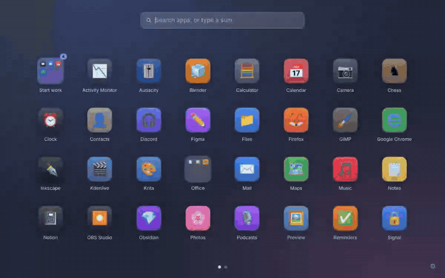
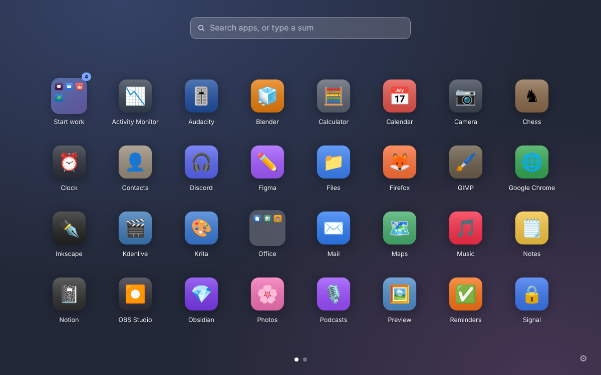
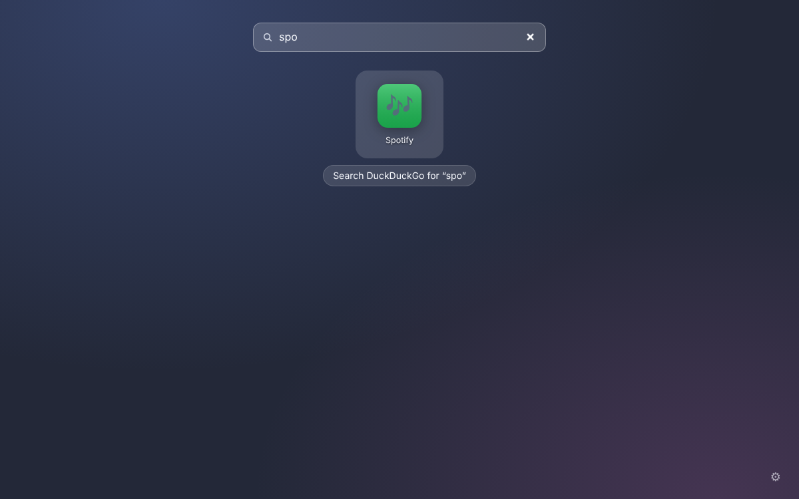
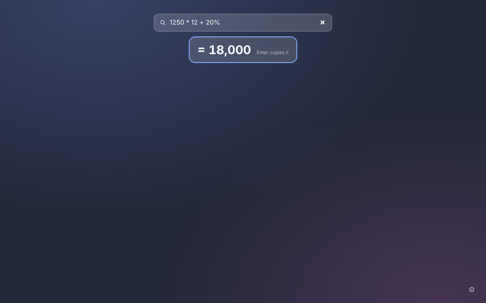
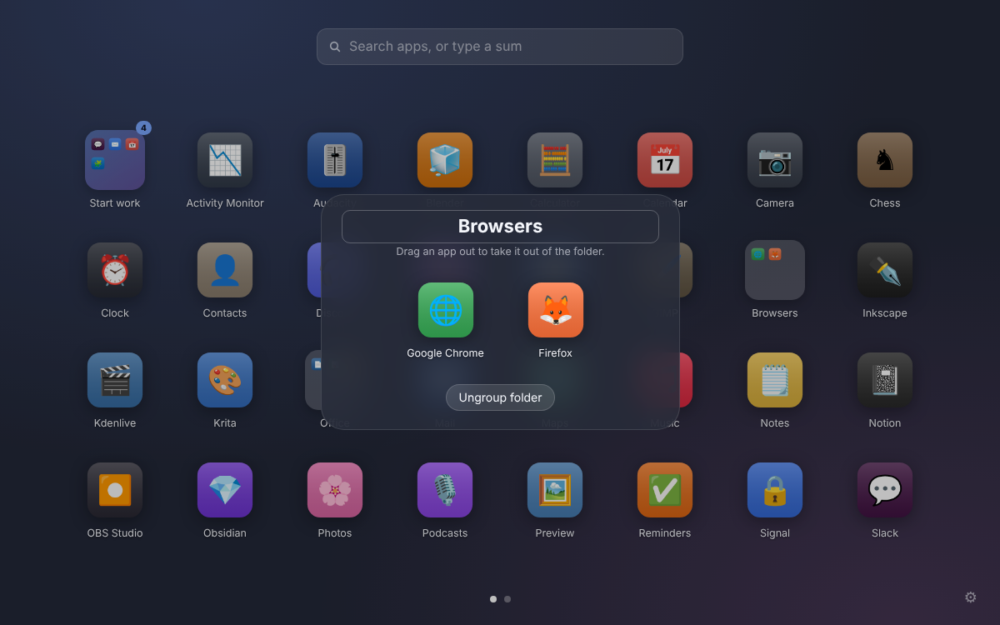
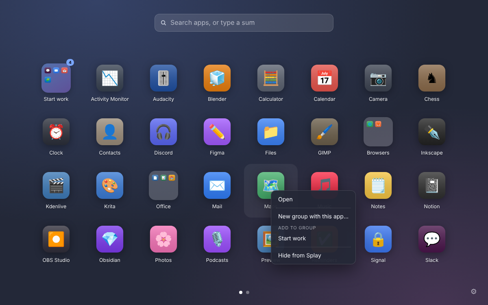
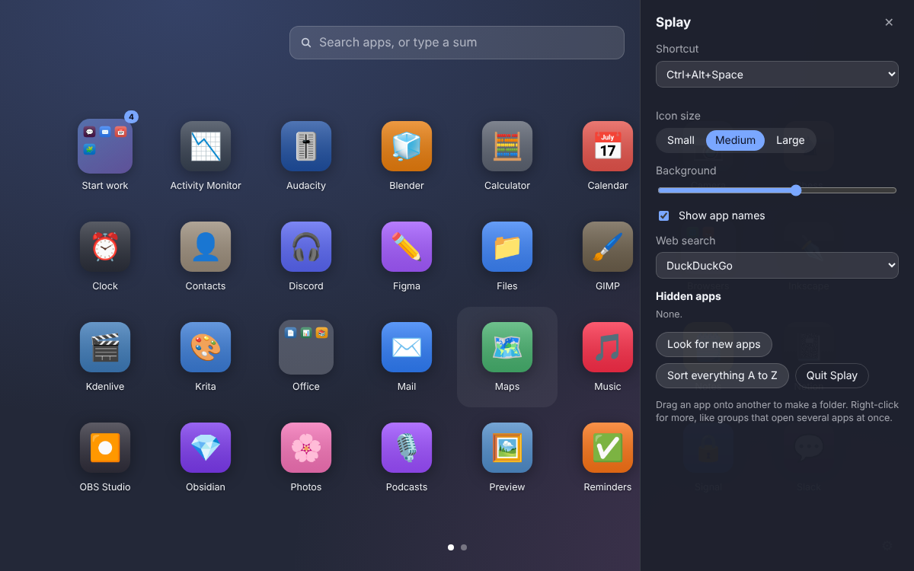
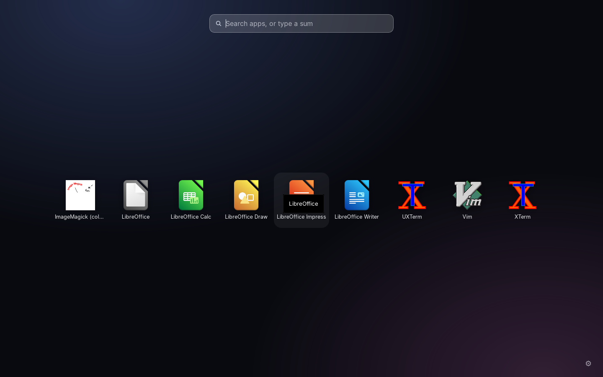

<div align="center">


# Splay

**All your apps on one screen, one shortcut away.**
Press **Ctrl Alt Space** and every app you have fills the screen, in pages and folders you arrange. Type to find one, do a quick sum, or open a whole group of apps at once.
Free and open source. No account, no subscription, nothing leaves your computer.

Windows · macOS · Linux



[Demo video (MP4)](docs/demo.mp4) · [Install](#install) · [What it does](#what-it-does) · [Compared to paid apps](#compared-to-paid-launcher-apps)

</div>

---

## Install

**Windows** (PowerShell, installs for your user only, no admin needed):

```powershell
irm https://raw.githubusercontent.com/llamaboi55/splay/main/scripts/install.ps1 | iex
```

**macOS and Linux:**

```sh
curl -fsSL https://raw.githubusercontent.com/llamaboi55/splay/main/scripts/install.sh | sh
```

Both commands download the latest release straight from GitHub and install it. Files fetched this way don't get flagged, so there's no "unknown publisher" warning to click through. Run the same command again to update. You can also download the installer for your system from [Releases](https://github.com/llamaboi55/splay/releases/latest).

**Build it yourself** (needs [Rust](https://rustup.rs) and Node.js 18+; on Linux also the [Tauri packages](https://tauri.app/start/prerequisites/)):

```sh
git clone https://github.com/llamaboi55/splay && cd splay && npm install && npm run build
```

**Just look at it** (no install): `npm run preview`, then open the printed address. It shows Splay with pretend apps.

## What it does

- **Every app, full screen.** Press **Ctrl Alt Space** (or click the tray icon) and Splay covers the screen your mouse is on with all your apps, A to Z to start with. Scroll, use the arrow keys or click the dots to change page. Press **Esc**, click empty space or switch apps to close it.
- **Search as you type.** Just start typing. It matches the start of a name, any word in it, initials ("vsc" finds Visual Studio Code) and letters in order. Apps you open more often come first. Press **Enter** to open the top one.
- **Calculator built in.** Type a sum like `1250 * 12 + 20%`, `sqrt(81)` or `15% of 240` and the answer shows straight away. **Enter** copies it.
- **Search the web** when no app matches, with DuckDuckGo, Google, Bing, Brave or Startpage.
- **Your own arrangement.** Drag apps to reorder them. Drop one app on another to make a folder, then name it. Drag apps out of a folder to take them out.
- **Groups open several apps at once.** Right-click an app, choose **New group with this app**, and add others the same way. One click on the group opens them all, like a "Start work" group with mail, chat, calendar and your editor.
- **Tidy.** Hide apps you never use (bring them back in Settings). New apps show up on their own at the end.
- **Settings:** shortcut, icon size, background darkness, app names on or off, web search engine, start with your computer.

| | |
|---|---|
|  |  |
|  |  |
|  |  |

Running on Linux with the apps actually installed there, icons from the system theme:



## Compared to paid launcher apps

| | Splay | Typical paid app |
|---|---|---|
| Price | Free | subscription or lifetime licence |
| Windows and Linux | ✅ | ❌ Mac only |
| Full-screen grid with pages | ✅ | ✅ |
| Folders by drag and drop | ✅ | ✅ |
| Search with initials and letters in order | ✅ | ✅ |
| Calculator in the search box | ✅ | ✅ |
| Groups that open several apps | ✅ | ✅ (workflows) |
| Hide apps | ✅ | ✅ |
| Web search fallback | ✅ | some |
| Open source | ✅ | ❌ |

## Privacy

Splay looks at the folders where apps are installed to list them and their icons, and remembers your arrangement and how often you open each app, all on your computer. It only connects to the internet if you choose a web search.

## Good to know

- **Where apps come from.** Windows: the Start menu (apps from the Microsoft Store that don't put a shortcut there won't show). macOS: Applications, Applications/Utilities, System Applications and your own Applications folder. Linux: the standard app menu entries, including Flatpak and Snap.
- **Shortcut taken?** Pick another in Settings: Ctrl Alt Space, Alt Shift Space, Ctrl Shift Space, Alt Space or F4.
- **Linux:** the see-through background needs a compositor (GNOME, KDE, Cinnamon and most modern desktops have one). On Wayland, global shortcuts depend on your desktop; bind a key to `splay` in your system settings if Ctrl Alt Space doesn't open it.

## Development

```sh
npm install
npm run preview      # the launcher in a browser with pretend apps, no Rust build needed
npm run dev          # the real app with hot reload
npm test             # search, calculator and layout tests (node --test) and Rust tests
```

- `src/js/search.js`: matching apps as you type (tested)
- `src/js/calc.js`: the calculator, a small parser with no eval (tested)
- `src/js/layout.js`: pages, folders, groups, hidden apps (tested)
- `src/js/app.js`: the launcher screen, dragging, menus, settings
- `src-tauri/src/apps.rs`: finding apps, their icons, and opening them on each system (tested)
- `src-tauri/src/lib.rs`: the window, global shortcut and tray

Releases are built for all three systems by GitHub Actions whenever the version in `src-tauri/tauri.conf.json` changes on `main`.

## Where the idea came from

Found through this Instagram Reel: https://www.instagram.com/p/DapqR1JGeax/ (and a similar one: https://www.instagram.com/p/DdUO996EyPu/)
This project isn't affiliated with the app shown there.

## License

MIT. Splay is an independent project and isn't affiliated with any other launcher app.
